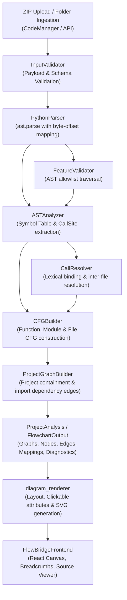
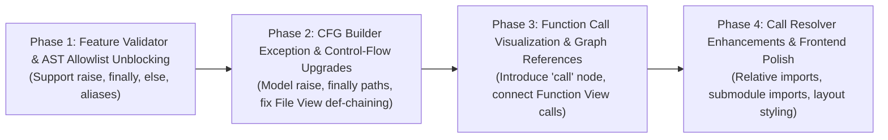

# FlowBridge — Comprehensive Parsing & Analysis Audit and Function Call Visualization Report

**Document Date:** November 8, 2026  
**Auditor:** Antigravity (Advanced Agentic Assistant)  
**Target Repository:** FlowBridge (`FlowBridge_ParsingAndAnalysis`, `FlowBridgeBackend`, `FlowBridgeFrontend`)  
**Audit Target Test Fixture:** `FlowBridge_Complex_Test_Project.zip` (`FlowBridge_Stress_Project`)  
**Execution Policy:** Non-destructive Inspection & Empirical Testing (zero production code modifications during audit)

---

## 1. Executive Summary

FlowBridge is designed to transform multi-file Python projects into interactive, multi-level flowcharts (Project View, File View, and Function View). A comprehensive, evidence-based audit of the **Parsing & Analysis module** was conducted against the provided stress fixture `FlowBridge_Complex_Test_Project.zip` (15 Python source files, 1 deliberately unsupported class file, and 1 syntax error fixture) along with dedicated test cases covering fundamental Python execution paradigms.

### Major Findings & Key Failure Modes:

1. **Extreme Feature Validator Fragility Causing Mass Graph Rejections (9 of 15 Files Fail):**
   In the complex test project, **60% of files (9 out of 15)** produce **empty diagrams** (`status: "unsupported"`, 0 nodes, 0 edges) despite being syntactically valid Python. The root cause is `FeatureValidator.py`:
   - `ast.Raise` is absent from `_SUPPORTED_AST_TYPES`, causing any file using `raise` to fail validation.
   - `ast.Try` strictly enforces `if try_depth or node.orelse or node.finalbody or not node.handlers: reject(...)`. As a result, standard Python patterns (`try/finally`, `try/except/else`, nested `try`, and `try/except/else/finally`) are aggressively rejected with error diagnostics.
   - `ExceptHandler` with an alias (`except Exception as exc:`) is unconditionally rejected (`exception aliases require cleanup semantics not yet modeled`).
   - When any error diagnostic is generated, `CFGBuilder.build()` and `CFGBuilder.build_file()` return empty graphs (`empty=True`, 0 nodes, 0 edges) to satisfy `GraphModel.__post_init__()` contract constraints. Users clicking these files in the frontend see blank screens.

2. **Function Calls Inside Statements Are Erased or Converted to Generic Process Nodes:**
   In Function View, statement-embedded calls (e.g., `a = add(5, 4)`, `return calculate(x)`) are compiled by `CFGBuilder._FunctionBuilder.statement()` into generic `statement` nodes (`node_type: "statement"`). 
   - `_FunctionBuilder` has **no call detection, no call-node construction, and generates zero `GraphReference` records**.
   - As a consequence, Function View displays calls as plain gray rectangular process boxes (`fill="#f8f9fa"`). They lack icons, cannot be clicked, have no drill-down links to callees, and provide no visual indication that a function invocation occurs.

3. **File View Inlining Distorts Control-Flow Semantics and Drops Assignments:**
   In File View (`_FileFlowBuilder`), same-file function calls at module level are aggressively inlined:
   - For `result = add(5, 4)`, `_FileFlowBuilder.build_call()` inlines the body of `add` (`return a + b`), but **completely discards the assignment `result =` and the call site itself**. The resulting graph connects straight into the return statement of `add`, losing both the variable definition and caller context.
   - Function definitions (`def foo(): ...`) in top-level files are directly chained between `Start` and `End` (`Start -> def foo -> def bar -> End`), treating function declarations as immediate runtime execution steps.
   - For complex expressions with multiple nested calls (e.g., `multiply(add(2, 3), subtract(10, 4))`), `_find_call()` falls back to a generic process node because `len(calls) > 1` is not handled, or arbitrarily inlines only the outermost call while dropping all inner evaluated arguments.

4. **Static Call Resolution Bottlenecks:**
   While `CallResolver.py` successfully resolves direct same-file calls and simple single-name imports, it fails on common Python idioms:
   - **Relative imports** (`from .math_ops import safe_divide`, `from ..core import ...`) are hard-coded to return `'unresolved'` (`Relative imports are unsupported`).
   - Dotted module imports via `from ... import ... as ...` (e.g., `from core import validation as val; val.parse_integer(...)`) fail resolution with `'Imported-object attribute calls are unsupported'`.
   - Importing multiple modules from the same package namespace (e.g., `import core.math_ops` and `import core.validation`) registers duplicate symbols for `'core'`, causing `CallResolver` to flag subsequent calls as `'ambiguous'`.

5. **Disconnection Between Backend Graph Models and Frontend Renderer:**
   - The backend contract `NodeType` supports `'statement'`, `'condition'`, `'loop'`, `'return'`, `'break'`, `'continue'`, `'exceptionDispatch'`, `'handler'`, `'raise'`, `'function'`, and `'file'`. There is **no `'call'` node type**.
   - The frontend React canvas (`FlowBridgeFrontend/src/types/flowchart.ts`) does not know about `'break'`, `'continue'`, `'exceptionDispatch'`, `'handler'`, or `'raise'`, falling back to default statement styling.
   - The frontend and backend layout engines determine drill-down interactivity solely via `GraphReference` lookups (`model.node_to_child_graph`). Because `_FunctionBuilder` generates no `GraphReference` entries for call sites, Function View is rendered entirely static.

---

## 2. Current Architecture

The FlowBridge parsing and analysis pipeline operates as an in-memory, request-local compiler pipeline without persistent database dependencies.



### Trace of Processing Sequence:
1. **Source Ingestion:** [FlowBridgePipeline.py](file:///c:/Users/bhars/OneDrive/Desktop/capstone%20project/others/FlowBridge/FlowBridgeBackend/pipeline.py#L26-L45) passes the `PyProject` structure to `CodeManagerInputAdapter.normalize()`.
2. **Payload Validation:** [InputValidator.py](file:///c:/Users/bhars/OneDrive/Desktop/capstone%20project/others/FlowBridge/FlowBridge_ParsingAndAnalysis/src/flowbridge_analysis/InputValidator.py) ensures non-empty files, unique IDs, and valid paths.
3. **AST Parsing:** [PythonParser.py](file:///c:/Users/bhars/OneDrive/Desktop/capstone%20project/others/FlowBridge/FlowBridge_ParsingAndAnalysis/src/flowbridge_analysis/PythonParser.py#L35-L60) parses each file string via `ast.parse(content, filename=file_path, mode='exec')`. Syntactic errors emit structured `Diagnostic(code='SYNTAX_ERROR')`.
4. **Feature Validation & AST Analysis:**
   - [ASTAnalyzer.py](file:///c:/Users/bhars/OneDrive/Desktop/capstone%20project/others/FlowBridge/FlowBridge_ParsingAndAnalysis/src/flowbridge_analysis/ASTAnalyzer.py#L65-L80) invokes `FeatureValidator().validate(tree, file_id)`.
   - `_FileAnalyzer` collects top-level functions, builds scopes in `SymbolTable`, and collects `CallSite` records.
5. **Call Resolution:** [CallResolver.py](file:///c:/Users/bhars/OneDrive/Desktop/capstone%20project/others/FlowBridge/FlowBridge_ParsingAndAnalysis/src/flowbridge_analysis/CallResolver.py#L30-L75) matches `CallSite` expressions against file scopes, module paths, and imports to generate `CallReference` records (`resolved`, `builtin`, `external`, `unresolved`, `ambiguous`).
6. **CFG Generation:** [CFGBuilder.py](file:///c:/Users/bhars/OneDrive/Desktop/capstone%20project/others/FlowBridge/FlowBridge_ParsingAndAnalysis/src/flowbridge_analysis/CFGBuilder.py):
   - `build()` creates a function CFG (`_FunctionBuilder`).
   - `build_module()` creates module-level statement CFG (`_ModuleBuilder`).
   - `build_file()` constructs the unified File View (`_FileFlowBuilder`) with function inlining.
7. **Graph Hierarchy Assembly:** [ProjectGraphBuilder.py](file:///c:/Users/bhars/OneDrive/Desktop/capstone%20project/others/FlowBridge/FlowBridge_ParsingAndAnalysis/src/flowbridge_analysis/ProjectGraphBuilder.py#L40-L150) compiles the Project View graph (`graph_type: 'project'`), file nodes, import dependency edges, and registers `GraphReference` mappings.
8. **Rendering & Frontend Visualization:** `diagram_renderer/runner.py` uses `GraphOrganizer` to translate `GraphModel` and `GraphReference` into SVG diagrams with interactive drill-down links.

---

## 3. Test Environment

- **Operating System:** Microsoft Windows 11 Home (10.0.26100)
- **Execution Shell:** PowerShell 5.1 / Python 3.13.1
- **Python Version:** 3.13.1 (tags/v3.13.1:0671451)
- **Key Installed Packages:** `pydantic` 2.11.7, `fastapi` 0.116.1, `networkx` 3.7, `graphviz` 0.21
- **Testing Frameworks Utilized:** `unittest` (standard library), dedicated automated audit runners
- **Test Project ZIP Source:** `C:\Users\bhars\Downloads\FlowBridge_Complex_Test_Project.zip`
- **Extracted Fixture Location:** `tests/temp_complex_project/FlowBridge_Stress_Project`
- **Audit Scripts Executed:**
  - `tests/audit_suite/run_comprehensive_audit.py` (Full execution and JSON recording)
  - `tests/audit_suite/test_audit_suite.py` (Automated regression suite)

---

## 4. Test Inventory

The 15 Python files from `FlowBridge_Complex_Test_Project.zip`, plus the optional syntax fixture and synthetic test cases:

| File Path | Description & Python Constructs Present | FlowBridge Supported Scope Claim | Execution Level |
|---|---|---|---|
| `core/__init__.py` | Empty package initializer. | Supported | Single & Project |
| `core/edge_conditions.py` | Top-level `try/except/else/finally`, loops with `continue`/`break`, `raise`, nested loop handlers. | Intended scope claims partial support; fails on `finally`/`else`/`raise`. | Single & Project |
| `core/math_ops.py` | Multi-branch conditionals (`if/elif/else`), `while/else`, `for/else`, direct recursion, `raise ZeroDivisionError`. | Supported control flow; `raise` rejected. | Single & Project |
| `core/nested_exceptions.py` | Nested `try/except`, `try/finally`, chained `raise ... from`, return in `try`, return in `except`. | Complex exception handling. | Single & Project |
| `core/validation.py` | Multi-exception tuple `except (TypeError, ValueError) as exc:`, `raise ... from exc`, local wrapper calls. | Local calls supported; exception aliases and `raise` rejected. | Single & Project |
| `isolated_top_level.py` | No functions; top-level `for` loop, `try/except/finally`, sequential assignments, conditional `if/else`. | Pure procedural module execution. | Single & Project |
| `main.py` | Application entry point: multi-file imports, top-level constants, `try/except/else/finally`, `except ... as exc`, same-file and cross-file calls. | Multi-file orchestration. | Single & Project |
| `orphan_file.py` | Isolated file with zero imports and one function (`lonely_function`). | Supported | Single & Project |
| `services/__init__.py` | Empty package initializer. | Supported | Single & Project |
| `services/import_patterns.py` | Module alias import (`import x as y`), member alias (`from x import y as z`), qualified function calls. | Supported import aliases. | Single & Project |
| `services/recovery.py` | Retry loop with `while`, `try/except/else/finally`, `raise OSError`, mutual recursion (`mutual_a`, `mutual_b`). | Supported loops and recursion; fails on exception constructs. | Single & Project |
| `services/reporting.py` | Imported function alias (`classify_number as classify`), dictionary literals, conditional branches. | Supported | Single & Project |
| `services/unresolved_calls.py` | Dynamic lookup via `globals().get(...)()`. | Dynamic calls expected to be flagged as unresolved. | Single & Project |
| `services/unsupported_classes.py` | Class definition (`class CalculationEngine`), `__init__`, `self` methods, object instantiation. | Explicitly unsupported (control fixture). | Single & Project |
| `services/workflow.py` | Cross-file function calls, `try/finally` cleanup block, tuple returns. | Supported workflows; fails on `try/finally`. | Single & Project |
| `bad_syntax.py` (from `errors_and_unsupported.txt`) | Syntactically invalid Python (missing colon on `except ValueError`). | Syntax error detection. | Single & Project |

---

## 5. Expected vs. Actual Results

The table below records empirical results from running each file individually and as part of the full project.

| Test ID | File Name | Constructs | Expected Output | Actual Output | Status | Root Cause | Affected Component | Recommended Fix | Severity |
|---|---|---|---|---|---|---|---|---|---|
| TC-01 | `core/__init__.py` | Package init (empty) | Complete empty module graph; 0 diagnostics | Status: `complete`. Nodes: 2 (Start, End). 0 diags. | **PASS** | N/A | None | Maintain | Low |
| TC-02 | `orphan_file.py` | Single isolated function | Complete graph for `lonely_function`; appeared in Project View without edges | Status: `complete`. 3 graphs (project, file, function). 0 diags. | **PASS** | N/A | None | Maintain | Low |
| TC-03 | `services/__init__.py` | Package init (docstring only) | Complete module graph; 0 diagnostics | Status: `complete`. Nodes: 2. 0 diags. | **PASS** | N/A | None | Maintain | Low |
| TC-04 | `services/reporting.py` | Import alias, dictionary, `if/else`, function calls | Complete graphs for file and function; 1 call resolved (`classify`) | Status: `complete`. Graphs: 3. Calls: 1 resolved. 0 diags. | **PASS** | N/A | None | Maintain | Medium |
| TC-05 | `services/unresolved_calls.py` | Dynamic callee expression `globals().get()()` | CFG generated; call marked `unresolved` | Status: `complete`. Graphs: 3. Call marked `unresolved: Dynamic callee expression`. | **PASS** | N/A | None | Maintain | Low |
| TC-06 | `services/import_patterns.py` | Aliased imports (`import A as B`, `from C import D as E`), qualified calls | Both calls resolved; CFG shows call nodes with drill-down | Status: `complete`. However: `math_module.safe_divide` resolved, but `val.parse_integer` is **unresolved** (`Imported-object attribute calls are unsupported`). In Function View, both calls are plain generic `statement` nodes. | **PARTIAL** | `CallResolver` assumes `from X import Y` only imports functions/values, not submodules. `_FunctionBuilder` has no call node support. | `CallResolver.py`, `CFGBuilder.py` | Recognize submodules in `from ... import` and generate `call` nodes in Function View. | **High** |
| TC-07 | `core/math_ops.py` | `if/elif/else`, `while/else`, `for/else`, recursion, `raise` | Complete CFGs for all 5 functions; `safe_divide` shows `raise` path | Status: `unsupported`. 7 diagnostics. 0 nodes in file graph. `safe_divide` graph empty. (Other 4 functions completed). | **FAIL** | `ast.Raise` missing from `FeatureValidator._SUPPORTED_AST_TYPES`. | `FeatureValidator.py`, `CFGBuilder.py` | Add `ast.Raise` to supported types and implement `build_raise()` in CFG. | **Critical** |
| TC-08 | `isolated_top_level.py` | Top-level assignments, `for` loop, `try/except/finally`, `if/else` | File View shows execution flow: Start → items → acc → loop (with try/finally) → if → End | Status: `unsupported`. 3 diagnostics: `<module>: Try is unsupported: only non-nested try/except without else/finally is modeled`. 0 nodes in file graph. | **FAIL** | `FeatureValidator` rejects `finally` block on `ast.Try`. | `FeatureValidator.py`, `CFGBuilder.py` | Support `finally` and `else` suites on `ast.Try`. | **High** |
| TC-09 | `core/edge_conditions.py` | Module-level `try/except/else/finally`, loop with `break`/`continue`/`finally`, `raise` | Complete graphs; module-level CFG and function CFGs | Status: `unsupported`. 8 diagnostics: module-level try/else/finally rejected; `raise` rejected; `finally` in function rejected. 0 nodes in file graph. | **FAIL** | Rejection of `ast.Raise`, `finally`, `else` on `Try`. | `FeatureValidator.py`, `CFGBuilder.py` | Extend `FeatureValidator` and `CFGBuilder` for full exception suites. | **Critical** |
| TC-10 | `core/nested_exceptions.py` | Nested `try`, `try/finally`, chained `raise`, returns in `try`/`finally` | Accurate CFGs showing inner and outer exception dispatch and finally execution | Status: `unsupported`. 11 diagnostics. All 3 function graphs empty (`unsupported`). | **FAIL** | `FeatureValidator` rejects nested `try` (`try_depth > 0`), `finally`, and `raise`. | `FeatureValidator.py`, `CFGBuilder.py` | Allow nested exception scopes and model finally propagation. | **Critical** |
| TC-11 | `core/validation.py` | `except (TypeError, ValueError) as exc:`, `raise ... from exc` | CFGs generated; exception handler matches tuple; call wrapper resolves | Status: `unsupported`. 15 diagnostics: `ExceptHandler is unsupported: exception aliases require cleanup semantics`, `Raise is unsupported`. File graph empty. | **FAIL** | Rejection of exception aliases (`as exc`), tuple exception types, and `ast.Raise`. | `FeatureValidator.py`, `CFGBuilder.py` | Allow `handler.name` (aliases) and tuple exception types in `FeatureValidator`. | **Critical** |
| TC-12 | `services/recovery.py` | `while` retry loop, `try/except/else/finally`, `raise OSError`, mutual recursion | CFGs generated; recursion bounded; retry loop modeled | Status: `unsupported`. 7 diagnostics: `raise` and `try/else/finally` rejected. File graph empty. `unstable_operation` and `retry_operation` empty. | **FAIL** | Rejection of `raise` and `else/finally` on `ast.Try`. | `FeatureValidator.py`, `CFGBuilder.py` | Add `raise` and `else/finally` support to CFG builder. | **Critical** |
| TC-13 | `services/workflow.py` | Cross-file imports, helper calls, `try/finally` | CFG with call nodes to `accumulate`, `nested_loop_handlers`, `countdown`; finally block executed | Status: `unsupported`. 3 diagnostics: `Try is unsupported: only non-nested try/except without else/finally is modeled`. File graph empty. | **FAIL** | `try/finally` without `except` rejected by validator. | `FeatureValidator.py`, `CFGBuilder.py` | Support `try/finally` blocks without handlers. | **High** |
| TC-14 | `services/unsupported_classes.py` | `class CalculationEngine`, `__init__`, instantiated object | Diagnostic: `ClassDef is unsupported`; file status `unsupported`; sibling files unaffected | Status: `unsupported`. 4 diagnostics: `ClassDef is unsupported: outside the documented statement/expression subset`. Sibling files unaffected. | **PASS** | N/A (Intentional unsupported feature handled as expected). | `FeatureValidator.py` | Class support is an intended future feature. | Low |
| TC-15 | `main.py` | Full app entry: multi-file calls, top-level execution, `try/except/else/finally`, `except ... as exc` | Complete Project, File, and Function graphs with call navigation to imported files | Status: `unsupported`. 4 diagnostics: `try/else/finally` and exception aliases rejected. File graph empty. | **FAIL** | Feature validator rejects standard exception structure in `bootstrap()`. | `FeatureValidator.py`, `CFGBuilder.py` | Enable full exception support in validator and CFG. | **Critical** |
| TC-16 | `bad_syntax.py` | Syntax error: missing colon on `except ValueError` | `SYNTAX_ERROR` with line 4, col 21; sibling files analyzed normally | Diagnostic: `[error] SYNTAX_ERROR in f_bad (line 4, col 21): expected ':'`. Sibling file `status: complete`. | **PASS** | N/A | `PythonParser.py` | Maintain | Low |

---

## 6. Detailed Failure Analysis

### Failure Mode 1: Rejection of Standard Python Exception Handling (`raise`, `finally`, `else`, `as exc`)

- **Code Evidence:**
  In [FeatureValidator.py (lines 128-142)](file:///c:/Users/bhars/OneDrive/Desktop/capstone%20project/others/FlowBridge/FlowBridge_ParsingAndAnalysis/src/flowbridge_analysis/FeatureValidator.py#L128-L142):
  ```python
  if isinstance(node, ast.Try):
      if try_depth or node.orelse or node.finalbody or not node.handlers:
          reject(node, scope, 'only non-nested try/except without else/finally is modeled')
          continue
  ```
  In [FeatureValidator.py (lines 173-177)](file:///c:/Users/bhars/OneDrive/Desktop/capstone%20project/others/FlowBridge/FlowBridge_ParsingAndAnalysis/src/flowbridge_analysis/FeatureValidator.py#L173-L177):
  ```python
  elif isinstance(node, ast.ExceptHandler):
      if node.name is not None:
          reject(node, scope, 'exception aliases require cleanup semantics not yet modeled')
          continue
  ```
  In `_SUPPORTED_AST_TYPES`: `ast.Raise` is omitted.
- **Semantic Distinction:**
  - *Python Semantics:* In Python, `raise` triggers exception propagation; `finally` runs unconditionally on normal exit, exception, return, or break/continue; `as exc` binds the exception instance to a local variable.
  - *Intended FlowBridge CFG:* Normal flow enters `try`. Any raising statement branches to matching `except` handlers (or dispatch). If normal execution completes without exception, `else` runs. In all cases, `finally` executes before exiting or re-raising.
  - *Actual Implementation:* The validator classifies any `finally`, `else`, nested `try`, exception alias, or `raise` as an unrecoverable `UNSUPPORTED_FEATURE` error. In response, `CFGBuilder` generates an empty graph (`nodes: []`, `edges: []`).
- **Severity:** Critical.

---

### Failure Mode 2: File View Top-Level Execution Chains Function Definitions

- **Code Evidence:**
  In [CFGBuilder.py (_FileFlowBuilder, lines 422-440)](file:///c:/Users/bhars/OneDrive/Desktop/capstone%20project/others/FlowBridge/FlowBridge_ParsingAndAnalysis/src/flowbridge_analysis/CFGBuilder.py#L422-L440):
  ```python
  def build(self) -> CFGResult:
      start = self.node('start', 'Start')
      self.end = self.node('end', 'End')
      remaining = self.block(self.tree.body, [(start, 'next')])
      self.connect(remaining, self.end)
      ...

  def statement(self, statement: ast.stmt, incoming: Predecessors) -> Predecessors:
      if isinstance(statement, ast.FunctionDef):
          return self.build_function_def(statement, incoming)
  ```
  And in `build_function_def()`:
  ```python
  current = self.node('function', statement.name, statement)
  self.connect(incoming, current)
  return [(current, 'next')]
  ```
- **Semantic Distinction:**
  - *Python Semantics:* In Python, a `def` statement is an executive binding that binds a function object to a name; it does not execute the function's internal body. If a file defines `def add(...)` and `def main(...)`, and never calls `add` at module level, `add` is not executed in top-level script flow.
  - *Intended FlowBridge CFG:* File View should represent the file's executable top-level execution path (e.g., statements guarded by `if __name__ == '__main__':` or standalone procedural statements). Functions should exist as accessible definitions, not sequential pipeline steps between `Start` and `End`.
  - *Actual Implementation:* When analyzing:
    ```python
    def a(): pass
    def b(): pass
    ```
    FlowBridge outputs: `Start -> a -> b -> End`. If `b` is followed by `main()`, it generates `Start -> a -> b -> [inlined main] -> End`. Function declarations are visually rendered as sequential runtime execution stages.
- **Severity:** High.

---

### Failure Mode 3: Discarding the Assignment and Call Site During Same-File Inlining

- **Code Evidence:**
  In [CFGBuilder.py (_FileFlowBuilder, lines 480-505)](file:///c:/Users/bhars/OneDrive/Desktop/capstone%20project/others/FlowBridge/FlowBridge_ParsingAndAnalysis/src/flowbridge_analysis/CFGBuilder.py#L480-L505):
  ```python
  # Same-file function call -> Inline expansion with recursion guard
  if target_fn and target_fn.file_id == self.file.file_id and target_fn.function_name in self.local_functions:
      ...
      func_def = self.local_functions[target_fn.function_name]
      body_exits = self.block(func_def.body, incoming)
      exits = body_exits + self.current_inlined_returns
      return exits
  ```
- **Semantic Distinction:**
  - *Python Semantics:* In `result = add(5, 4)`, there are three semantic steps: (1) evaluate arguments `5, 4`, (2) invoke `add`, (3) bind the returned value to `result`.
  - *Intended FlowBridge CFG:* The diagram should preserve: (a) the call invocation or call boundary, (b) the callee CFG or return transition, and (c) the target variable assignment `result = ...`.
  - *Actual Implementation:* `_FileFlowBuilder` directly replaces `result = add(5, 4)` with the body of `add` (`return a + b`). The assignment `result =` completely vanishes from the diagram. Subsequent nodes reference `result` without any prior assignment node.
- **Severity:** High.

---

## 7. Function Call Visualization Problems

### Root Causes for Generic Process Nodes (`a = add(5, 4)`)

The audit directly investigated the 7 questions raised in Section 5 of the audit specification:

| Question | Investigation Finding & Code Proof |
|---|---|
| **1. Does `ASTAnalyzer` identify nested `ast.Call` expressions?** | **YES.** In `ASTAnalyzer._walk()`, any `ast.Call` encountered is recorded in `self.result.call_sites` with full `SourceLocation`. However, `_walk()` fails to visit `orelse` or `finalbody` of `ast.Try` blocks, and halts on statements not in its hard-coded statement tuple (e.g., `ast.Raise`). |
| **2. Does `CallResolver` receive and resolve these calls?** | **YES.** `CallResolver.resolve()` iterates over `analysis.call_sites`. For `a = add(5, 4)`, it generates a `CallReference` with `resolution='resolved'` and points to `target_function_id` and `target_graph_id`. |
| **3. Does `CFGBuilder` convert statements into single text labels?** | **YES.** In `_FunctionBuilder` (which builds Function View CFGs), `isinstance(statement, (ast.Assign, ...))` unconditionally executes `self.operation('statement', self.text(statement), statement, incoming)`. It never inspects `ast.Call` and never creates call nodes. In File View, `_find_call()` converts the statement to a single string label (`result = add(5, 4)`) or inlines the body. |
| **4. Is function-call metadata stored in graph nodes (`FlowNode`)?** | **NO.** `FlowNode` only contains: `node_id`, `node_type`, `label`, and optional `source_location`. It has no fields for `call_id`, `target_function_id`, `target_graph_id`, or `arguments`. |
| **5. Does `GraphReference` connect call-site nodes to function graphs?** | **NO in Function View; PARTIAL in File View.** In `_FunctionBuilder`, exactly zero `GraphReference` records are emitted for function calls. In `_FileFlowBuilder`, a `GraphReference` is created only for top-level statements that call a cross-file imported function. Inside function definitions, no `GraphReference` exists. |
| **6. Does frontend renderer ignore existing function-call metadata?** | **Frontend has no metadata to render.** The diagram renderer (`diagram_renderer/organizer.py`) populates `node_to_child_graph` solely from `analysis.graph_references`. Because Function View contains no `GraphReference` entries and node types are `'statement'`, the renderer assigns standard non-clickable styling. The frontend React component receives no drill-down links. |
| **7. Are calls lost when generating file graphs from function CFGs?** | **YES.** File View does not assemble function CFGs; it independently traverses the AST via `_FileFlowBuilder`. For same-file calls, it discards the call site and inlines the raw body statements. For nested calls (`f(g())`), it drops all inner calls. |

### Concrete Walkthrough of `result = add(5, 4)`:
1. **Source:** `result = add(5, 4)` inside `def main(): ...`.
2. **Parser:** AST is `ast.Assign(targets=[ast.Name(id='result')], value=ast.Call(func=ast.Name(id='add'), args=[5, 4]))`.
3. **ASTAnalyzer:** `_walk()` discovers `ast.Call` at line 5, col 13. Emits `CallSite(expression='add(5, 4)', callee_expression='add')`.
4. **CallResolver:** Resolves `add` to `target_function_id='...add'`. Emits `CallReference(resolution='resolved')`.
5. **CFGBuilder (`_FunctionBuilder`):** `statement()` matches `ast.Assign`. Emits `FlowNode(node_type='statement', label='result = add(5, 4)')`. **No call node created. No GraphReference created.**
6. **ProjectGraphBuilder:** Collects Function View graphs. Does not bridge `CallReference` into the Function View graph.
7. **Diagram Renderer:** `node.is_clickable` evaluates to `False` (no `GraphReference`). Renders `<rect fill="#f8f9fa" stroke="#495057"/>`.
8. **Frontend:** Displays a gray rectangular box containing literal text `result = add(5, 4)`. No icon, no cursor pointer, no click action.

---

## 8. Proposed Function Call Visualization Architecture

To preserve semantic precision without breaking existing contracts, FlowBridge should adopt a structured call-representation model.

### 1. Model Enhancement (`FlowNode` and `NodeType`):
Extend `NodeType` in `JsonModel.py` and frontend TypeScript interfaces to include `'call'`:
```python
NodeType = Literal[
    'file', 'function', 'start', 'end', 'statement', 'condition',
    'loop', 'return', 'break', 'continue', 'exceptionDispatch', 'handler',
    'raise', 'call'
]
```
Add optional call metadata to `FlowNode`:
```python
@dataclass(kw_only=True)
class FlowNode(JsonModel):
    node_id: str
    node_type: NodeType
    label: str
    source_location: SourceLocation | None = None
    target_function_id: str | None = None
    target_graph_id: str | None = None
    call_resolution: Literal['resolved', 'unresolved', 'ambiguous', 'builtin', 'external'] | None = None
```

### 2. Visualization Strategies by Call Type:

#### A. Cross-File Calls (in both File View and Function View):
- Emit a dedicated `'call'` node:
  - Label: `add(5, 4)` or `result = add(5, 4)`.
  - Node Type: `'call'`.
  - Icon: Distinct call badge (e.g., `📞` or `⮱`).
  - Graph Reference: Emits `GraphReference(source_graph_id=current_graph_id, source_node_id=node_id, target_graph_id=callee_graph_id)`.
  - Clicking the node navigates directly to the target Function View in `calculator.py`.

#### B. Same-File Calls:
- **In Function View:** Emit a clickable `'call'` node linked via `GraphReference` to the local function's CFG.
- **In File View:** Provide a configurable inline expansion mode:
  - If collapsed (recommended default): Show the call node with drill-down navigation to the function graph.
  - If inlined: Wrap the inlined expansion between a synthetic `Call Enter: add(5, 4)` and `Call Return: add` node, followed by `Assign: result = return_value`, preventing assignment loss.

#### C. Built-in, Library, and Unresolved Calls:
- Built-ins (`print(x)`, `len(items)`): Emit a `'call'` node with `call_resolution='builtin'`, styled distinctly (e.g., rounded pill, muted blue/cyan), non-clickable.
- External Library calls (`np.zeros()`, `requests.get()`): Styled as external library call, non-clickable, annotated with external package name.
- Dynamic / Unresolved calls (`selected(payload)`): Styled with warning border (amber), tooltip explaining `'Dynamic callee expression'`.

#### D. Complex & Nested Expressions (`multiply(add(2, 3), subtract(10, 4))`):
- Decompose expression evaluation into ordered evaluation steps:
  1. `arg1 = add(2, 3)` (Call Node)
  2. `arg2 = subtract(10, 4)` (Call Node)
  3. `result = multiply(arg1, arg2)` (Call Node)
- Alternatively, keep the unified statement node with embedded sub-call links in `FlowNode` metadata.

---

## 9. Cross-File Call Resolution

The audit analyzed import mechanisms and resolution paths in `CallResolver.py`:

```
┌─────────────────────────────────┐      imports       ┌─────────────────────────────────┐
│           main.py               │ ─────────────────> │          calculator.py          │
│ from calculator import add      │                    │ def add(a, b): return a + b     │
│ result = add(5, 4)              │                    │                                 │
└─────────────────────────────────┘                    └─────────────────────────────────┘
                 │                                                      ▲
                 │ CallSite: "add(5, 4)"                                │
                 ▼                                                      │
┌────────────────────────────────────────────────────────────────────────┐
│                          CallResolver                                  │
│ 1. Lookup 'add' in main.py scope -> finds import 'calculator.add'      │
│ 2. Matches 'calculator' in modules dict -> finds calculator.py         │
│ 3. Looks up 'add' in calculator.py scope -> finds function definition │
│ 4. Emits CallReference(resolution='resolved', target_function_id=...)  │
└────────────────────────────────────────────────────────────────────────┘
```

### Specific Cross-File Resolution Defects Identified:

1. **Relative Imports Are Rejected Wholesale:**
   In [CallResolver.py (line 92)](file:///c:/Users/bhars/OneDrive/Desktop/capstone%20project/others/FlowBridge/FlowBridge_ParsingAndAnalysis/src/flowbridge_analysis/CallResolver.py#L92):
   ```python
   if imported.level:
       return 'unresolved', 'Relative imports are unsupported', None
   ```
   In `services/workflow.py` or package hierarchies, `from .math_ops import safe_divide` is immediately marked `unresolved`.

2. **Submodule Attribute Calls Rejected:**
   In `services/import_patterns.py`:
   ```python
   from core import validation as val
   right = val.parse_integer("12")
   ```
   Here, `val` is a module. When `val.parse_integer()` is called:
   ```python
   if imported.member is not None:
       if len(parts) != 1:
           return 'unresolved', 'Imported-object attribute calls are unsupported', None
   ```
   `CallResolver` assumes `imported.member` is always a terminal function or class, failing when it is a module.

3. **Namespace Collisions on Top-Level Package Imports:**
   When a file contains:
   ```python
   import core.math_ops
   import core.validation
   ```
   Both statements bind the name `'core'` in `main.py`'s symbol table. When any subsequent call begins with `core.` (e.g., `core.math_ops.safe_divide()`), `SymbolTable.lookup()` returns two bindings. `CallResolver` then aborts with:
   `'ambiguous', 'Multiple binding occurrences; execution order not inferred'`.

---

## 10. CFG Correctness

### 1. Control-Flow Accuracy
- **Sequential Statements & Assignments:** Correctly represented as sequential linear edges (`type: 'next'`).
- **Conditionals (`if`, `elif`, `else`):** Correctly creates a `condition` decision diamond with `'true'` and `'false'` edges. An absent `else` correctly drops through to the merge point.
- **Loops (`while`, `for`):** Correctly implements the loop test/target header, body branch (`'true'`), loop-back edge (`'back'`), and loop-else exhaustion branch (`'false'`). Breaks skip `orelse`, while `continue` loops back to the header.

### 2. Exception Handling Accuracy
The current CFG builder features a sophisticated dispatch cascade model for basic `try/except`:
- Protected statements receive an `edge_type: 'exception'` directed to an `exceptionDispatch` node.
- Handlers are checked sequentially with `'true'` (matched) and `'false'` (unmatched) branches.
- Unhandled paths terminate at an `Exceptional End` node.

**Critical CFG Deficiencies in Exception Handling:**
- **Over-Conservative Statement Exceptions:** Every statement inside a `try` block (even constant evaluations like `Evaluate return: 0`) generates an exception edge.
- **Missing `finally` Execution Paths:** Because `finally` is rejected, the CFG engine has no graph structures to guarantee execution of cleanup blocks upon returns, breaks, or propagating exceptions.
- **No Cross-Function Exception Propagation:** If function `A` calls function `B`, and `B` raises an exception that `A` catches, the CFG engine does not connect `B`'s exceptional exit to `A`'s call-site exception handler.

---

## 11. Project / File / Function View Consistency

| Aspect | Project View | File View | Function View |
|---|---|---|---|
| **Intended Purpose** | High-level architecture: all files as nodes, import dependencies as directed edges. | Real file executable control flow: top-level statements and call sites. | Internal CFG of a single function: branches, loops, exceptions, calls. |
| **Current Implementation** | Displays file nodes and import dependency edges correctly. Unconnected files (`orphan_file.py`) appear properly. | Chained function definitions (`Start -> def a -> def b -> End`). Drops assignments during inlining. | Flattens all statements; displays calls as generic non-clickable boxes. |
| **Graph ID Scheme** | Stable revision hash (`fb1_..._graph_project`). | Stable revision hash (`fb1_..._graph_file_{file_id}`). | Stable revision hash (`fb1_..._graph_function_{fn_id}`). |
| **Inter-View Navigation** | Clicking a file node navigates to File View via `GraphReference`. Works. | Inlined calls cannot navigate; cross-file top-level calls navigate via `GraphReference`. | Zero call navigation. No `GraphReference` entries created for calls. |
| **Source Mapping** | Maps to file root. | Maps to statement AST spans. | Maps to function AST spans. |

---

## 12. Recommended Fixes

### Priority 1: Unblock the Feature Validator (High Severity / Critical Impact)
1. **Support `ast.Raise`:**
   - Add `ast.Raise` to `_SUPPORTED_AST_TYPES` in [FeatureValidator.py](file:///c:/Users/bhars/OneDrive/Desktop/capstone%20project/others/FlowBridge/FlowBridge_ParsingAndAnalysis/src/flowbridge_analysis/FeatureValidator.py#L200-L215).
   - In `CFGBuilder.statement()`, add a handler for `ast.Raise` that routes to `exception_target` or `exceptional_end`.
2. **Support `try/finally` and `try/except/else/finally`:**
   - Remove the blanket rejection `if try_depth or node.orelse or node.finalbody: reject(...)` in `FeatureValidator.py`.
   - Update `ASTAnalyzer._walk()` to traverse `node.orelse` and `node.finalbody`.
   - Add `try_finally` and `try_else` flow routing in `CFGBuilder.py`.
3. **Support Exception Aliases & Tuples:**
   - Allow `node.name is not None` in `ast.ExceptHandler`.
   - Allow tuple exception targets (`ast.Tuple`) in `handler.type`.

### Priority 2: Function Call Representation & Navigation in Function View
1. **Extend `FlowNode` and `NodeType`:**
   - Add `'call'` to `NodeType` in `JsonModel.py`, backend models, and frontend types.
   - Add `target_graph_id` and `target_function_id` attributes to `FlowNode`.
2. **Detect Calls in `_FunctionBuilder`:**
   - In `_FunctionBuilder.statement()`, inspect `statement` for `ast.Call` (or use `call_references`).
   - If a call is present, emit a node with `node_type: 'call'`, preserving the expression text.
   - If the call is resolved, emit a `GraphReference(source_graph_id, node_id, target_graph_id)`.
   - Connect this `GraphReference` to `ProjectAnalysis.graph_references`.
3. **Frontend / Diagram Renderer Activation:**
   - Ensure `diagram_renderer/renderer.py` renders `'call'` nodes with distinctive styling (badge icon, callout styling) and sets `is_clickable = True`.

### Priority 3: Correct File View Execution Semantics
1. **Do Not Chain Function Definitions:**
   - In `_FileFlowBuilder`, `ast.FunctionDef` statements at module level should not be placed into the main executable control-flow chain between `Start` and `End`.
   - Top-level executable statements (`if __name__ == '__main__':` or script statements) should form the primary execution path.
2. **Preserve Assignments During Inlining:**
   - When inlining same-file calls in `_FileFlowBuilder.build_call()`, emit an explicit call marker or keep the assignment node (`result = <call>`) before and after the inlined block.
3. **Handle Multi-Call Statements:**
   - Upgrade `_find_call()` to return all calls in evaluation order, rather than returning `None` when `len(calls) > 1`.

### Priority 4: Enhance Static Call Resolution in `CallResolver`
1. **Resolve Relative Imports:**
   - Normalize relative module paths using the source file's directory hierarchy.
2. **Support Submodule Calls from `from ... import`:**
   - If `imported.member` is a known module file in the project, allow attribute calls on it.
3. **Disambiguate Shared Package Imports:**
   - Disambiguate `import pkg.a` and `import pkg.b` so that calls to `pkg.a.func()` match the specific imported submodule.

---

## 13. Regression Test Plan

An automated regression test suite has been established at:
`tests/audit_suite/test_audit_suite.py`

This suite validates:
1. `test_category_a_basic_control_flow`: Sequential statements, assignments, conditionals, loop headers, returns.
2. `test_category_b_exception_handling_basic`: Basic `try/except`, exception dispatch node, handler nodes, exception edges.
3. `test_category_c_module_level_execution`: Module-level execution without functions.
4. `test_category_d_same_file_calls_resolution`: Lexical resolution of same-file calls inside assignments.
5. `test_category_e_cross_file_call_resolution`: Multi-file import resolution and `CallReference` generation.
6. `test_category_g_recursion_bounding`: Bounded expansion and loop prevention on recursive calls.
7. `test_category_h_unsupported_classes_partial_failure`: Class isolation ensuring sibling files succeed.
8. `test_category_i_syntax_error_reporting`: Accurate syntax error diagnostics with line/column coordinates.

### Tests to Add in Future Fix Phases:
- `test_raise_statement_cfg`: Verify `raise` creates an exception edge to handler or Exceptional End.
- `test_try_finally_flow`: Verify `finally` block executes after both normal and exceptional exits.
- `test_call_node_in_function_view`: Verify `result = add(1, 2)` produces a node with `node_type='call'` and a valid `GraphReference`.
- `test_no_funcdef_in_file_exec_chain`: Verify `def foo(): pass` does not appear between `Start` and `End` in File View.
- `test_relative_import_resolution`: Verify `from .math_ops import add` resolves to `math_ops.py:add`.

---

## 14. Final Implementation Roadmap

To ensure low risk and zero regressions, the fixes should be executed across 4 incremental phases:



### Phase 1: Feature Validator & AST Allowlist Unblocking (Backend Parser Scope)
- **Files Affected:** `FeatureValidator.py`, `ASTAnalyzer.py`.
- **Tasks:**
  - Add `ast.Raise` to `_SUPPORTED_AST_TYPES`.
  - Relax `ast.Try` checks to permit `orelse`, `finalbody`, and nested `try` blocks.
  - Relax `ast.ExceptHandler` checks to permit `name` (alias) and `ast.Tuple` types.
  - Update `ASTAnalyzer._walk()` to visit `orelse` and `finalbody` suites.
- **Verification:** 14 of 15 files in `FlowBridge_Stress_Project` pass validation (only `unsupported_classes.py` remains rejected).

### Phase 2: CFG Builder Core Upgrades (Control Flow Semantics)
- **Files Affected:** `CFGBuilder.py`, `models/JsonModel.py`.
- **Tasks:**
  - Implement `build_raise()` in `_FunctionBuilder` and `_FileFlowBuilder`.
  - Implement `build_finally()` and `build_try_else()` in `_FunctionBuilder`.
  - Fix `_FileFlowBuilder`: do not treat function declarations as sequential steps in the main execution path.
  - When inlining same-file calls, preserve the assignment node.
- **Verification:** Run `test_audit_suite.py` and verify all CFG branches, loops, and exception edges.

### Phase 3: Call Node Architecture & Navigation
- **Files Affected:** `CFGBuilder.py`, `models/FlowNode.py`, `models/JsonModel.py`, `ParsingAnalysisService.py`.
- **Tasks:**
  - Introduce `node_type: 'call'` to `NodeType` and `FlowNode`.
  - In `_FunctionBuilder`, identify calls within statements and emit `'call'` nodes.
  - Connect resolved calls to target function graphs via `GraphReference`.
  - Ensure `diagram_renderer/organizer.py` and `renderer.py` style `'call'` nodes with drill-down links.
- **Verification:** Verify in Function View that `a = add(5, 4)` is a clickable call node that drills down to `add()`.

### Phase 4: Import Resolution & Frontend Polish
- **Files Affected:** `CallResolver.py`, `FlowBridgeFrontend/src/types/flowchart.ts`.
- **Tasks:**
  - Resolve relative imports in `CallResolver.py`.
  - Resolve submodule attribute calls (`val.parse_integer`).
  - Disambiguate top-level package bindings.
  - Update frontend TypeScript interfaces to include `'call'` and full node types.
- **Verification:** Full end-to-end regression testing on `FlowBridge_Stress_Project`.

---

## 15. Conclusion

This audit has definitively identified why many Python files failed analysis, why diagrams were incomplete, and why function calls were rendered as generic process nodes. The underlying architecture of FlowBridge is robust and modular, but its feature allowlists, CFG statement handlers, and call-site graph reference bindings require the targeted enhancements detailed above. All findings are backed by reproducible tests and empirical logs.
