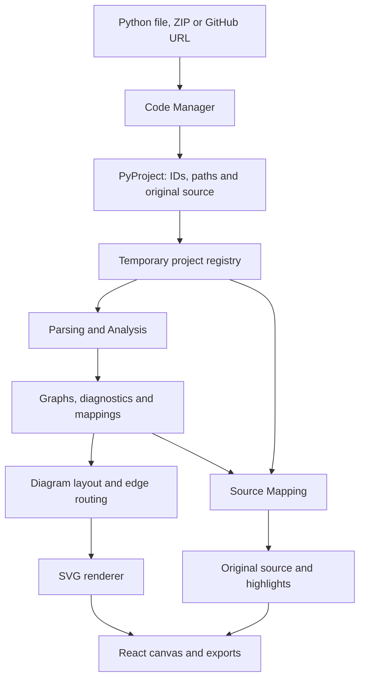

# FlowBridge

FlowBridge turns Python source into interactive project, file and function
flowcharts linked to the original code. Import a Python file, ZIP project or
public GitHub repository, inspect its flow, and export a diagram as SVG, PNG or PDF.
The capstone demo uses temporary storage with no sign-in or database.

## The Adaptables

| Team member | Focus |
| --- | --- |
| Justin Bean | Code Manager, source ingestion, data contracts and integration |
| Jerry Phan | Website, React interface, project views and frontend integration |
| Grace Medina | Source mapping, line/node indexing and source synchronization |
| Harsha Bonthu | Requirements, parsing, call resolution, CFGs and diagram layout/rendering |
| Kevin Sanchez | QA, testing, component validation and documentation verification |

## How it works

1. Code Manager validates an import and creates a `PyProject` with stable file
   IDs, relative paths and original decoded source. GitHub imports read the
   default branch's archive using the same ZIP reader as local uploads.
2. The temporary registry retains the snapshot. Parsing & Analysis uses Python's
   `ast` module to produce control-flow graphs, diagnostics and source mappings.
   Uploaded source is never executed, imported or installed.
3. The renderer lays out graphs and generates SVGs. The interface uses the same
   file IDs and source ranges to connect navigation, diagram clicks and source lines.



## Views and modules

- **Project view:** files and their static import relationships.
- **File view:** top-level execution with bounded same-file call expansion.
- **Function view:** branches, loops, returns and supported exception handling.
  Linked call nodes navigate to the corresponding function graph.

| Component | Location and responsibility |
| --- | --- |
| Code Manager | `FlowBridgeBackend/service.py`, `readers.py`, `github.py`: acquisition, encoding detection and source preservation |
| API and pipeline | `FlowBridgeBackend/api.py`, `pipeline.py`, `models.py`: validated project snapshots and consumer payloads |
| Parsing & Analysis | `FlowBridge_ParsingAndAnalysis/src/flowbridge_analysis/`: ASTAnalyzer, CFGBuilder, CallResolver, FeatureValidator and typed results |
| Diagram renderer | `FlowBridgeBackend/diagram_renderer/`: hierarchical organization, layout, edge routing and SVG generation |
| Source Mapping | `source_mapping.py` preserves the lookup API; `FlowBridgeBackend/SourceMapping/` builds UI indexes |
| Frontend | `FlowBridgeFrontend/src/App.tsx` and `components/`: navigation, source display, settings, imports and exports |

The layout separates true/false exit ports and routes long exception and loop
edges through outer channels. Complete diagrams preserve the graph's actual
execution edges. Unsupported constructs produce explicit diagnostics.

## Tech stack

| Technology | Use |
| --- | --- |
| Python 3.12, ast, tokenize and zipfile | Static analysis, source/comment locations, encoding and archive processing |
| FastAPI, Uvicorn and Pydantic | HTTP service, validated project models and JSON responses |
| HTTPX | Bounded public GitHub metadata/archive requests and redirect handling |
| React 18, TypeScript, Vite and Axios | Browser interface, typed payloads, builds and cancellable API requests |
| Custom SVG renderer | Diagram layout, navigation metadata and vector output |
| pytest, unittest, Vitest and Playwright | Backend, parser, component and browser verification |

## Run locally

Install Python 3.12, uv and Node 22 (version 22.12 or newer). From the repository root:

```powershell
uv sync --locked
uv run uvicorn FlowBridgeBackend.api:app --host 127.0.0.1 --port 8000
```

In another terminal:

```powershell
cd FlowBridgeFrontend
npm ci
npm run dev
```

Open [FlowBridge](http://localhost:5173). The [API documentation](http://127.0.0.1:8000/docs)
and [health check](http://127.0.0.1:8000/health) are available locally.

1. Import a Python file, ZIP project or public repository URL, then click Start.
2. Click linked nodes to open file/function views. Click statements or source
   line numbers to highlight their connection. Use breadcrumbs to go back.
3. Use Start New Project in the header to clear the view and open another import.
   It cancels pending diagram requests so old results cannot replace the new view.
4. The gear opens comment/docstring filtering. The profile button shows workspace
   information. Filtering preserves original files and line numbers.
5. Export the selected diagram as SVG, PNG or a diagram-sized PDF. Oversized PNG
   exports offer SVG instead. PDF diagrams start on the first page.

`VITE_API_BASE_URL` overrides the default API address, `http://localhost:8000`.
Additional frontend origins need matching backend `cors_origins` configuration.
Cloudflare deployment is maintained separately.

## Storage and supported Python

Use one backend worker for the demo. The registry retains up to 10 recently used
projects and 100 MiB of source text. New valid imports release least-recently
used snapshots when needed, so more than 10 ZIP uploads do not require a restart.
Expired IDs return a re-import message. Invalid or oversized imports do not
discard retained data.

Restarting clears source snapshots and temporary exports. Export URLs are
application/project/revision scoped; always use the URLs returned by the API.
Duplicate filenames have distinct identities and export paths.

Static analysis supports the documented procedural Python subset, including
branches, loops and bounded exception handling. Classes, async and other unsupported
constructs receive diagnostics. Each view is capped at 2,500 nodes to prevent
unbounded call expansion. See [parser details](docs/PARSER.md).

## Verification

```powershell
uv run python scripts/check_modules.py
uv run ruff check CodeManager.py FlowBridgeBackend flowbridge scripts tests
uv lock --check
uv build
cd FlowBridgeFrontend
npm test
npm run build
npx playwright install chromium
npm run test:browser
```

Latest local results: **264 backend tests, 301 parser tests, 33 frontend tests**
and **29 browser scenarios** passed. Browser checks use production assets and
an isolated API on ports 5188/8877. Their GitHub responses are deterministic;
separate live GitHub and installed-wheel checks are recorded in the validation log.
The repeated-import scenario uses 24 ZIPs with 10 Python files each, then four
concurrent imports. Intended-user validation is still pending.

GitHub Actions repeats module, frontend, browser, lint, build and installed-wheel
checks. Install dependencies and Chromium before presenting; keep a local Python
file or ZIP available for GitHub outages or rate limits.

## Documentation

- [Module handoff and HTTP contract](docs/HANDOFF.md)
- [Parser architecture and supported Python](docs/PARSER.md)
- [Executed verification and current limitations](docs/VALIDATION.md)
- [Archived plans, audits and reference notes](docs/archive/previous-project-notes.zip)

Historical notes remain in the archive and Git history. The parser package's
short README and developer guidance are retained. Source under its `reference/`
directory is supplied learning material, not the production implementation.
