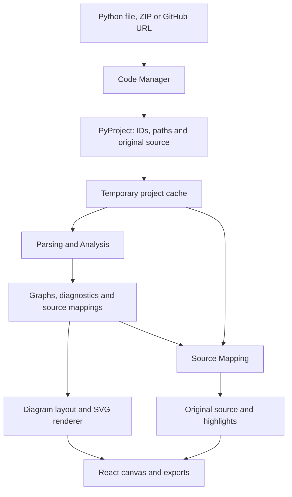

# FlowBridge

FlowBridge imports Python files, ZIP projects and public GitHub repositories,
then displays interactive diagrams connected to original source. The demo
includes navigation, source highlighting, comment filtering and SVG/PNG/PDF
exports. No sign-in or database is required.

## Run

Use Python 3.12 and Node 22.12 or newer. From the repository root:

```powershell
uv sync --locked
uv run uvicorn FlowBridgeBackend.api:app --host 127.0.0.1 --port 8000
```

In another terminal:

```powershell
cd FlowBridgeFrontend
npm ci
npm run dev
```

Open [the UI](http://localhost:5173). Import a project and click Start.
Click linked nodes to open file/function views; click statement nodes or source
lines to highlight their connection. Use breadcrumbs to go back.
The gear opens display settings, and the profile button shows the workspace.

Comment filtering hides comments/docstrings in the source pane without changing
original files or line numbers. Export saves the current diagram as SVG, PNG,
or a diagram-sized PDF.

## Modules



- Code Manager: `FlowBridgeBackend/service.py`, `readers.py`, `github.py`.
- Models/API: `FlowBridgeBackend/models.py`, `api.py`, `pipeline.py`.
- Analysis: `FlowBridge_ParsingAndAnalysis/src/flowbridge_analysis/`.
- Diagrams: `FlowBridgeBackend/diagram_renderer/` and the frontend canvas.
- Mapping: `source_mapping.py` preserves Grace's lookup API;
  `SourceMapping/` supplies the UI's node/line index.
- UI: `FlowBridgeFrontend/src/App.tsx` and `components/`.

## Session and limits

The server retains up to 10 recently used projects and 100 MiB of source text.
A new valid import releases least-recently used snapshots when space is needed;
more than 10 ZIP uploads do not require restarting. Expired IDs return a
re-import message. Invalid or oversized imports do not discard retained data.

Restarting the backend clears source snapshots and temporary exports.
Uploaded Python is parsed as text and never executed or installed.
See [supported Python and parser limits](docs/PARSER.md).

## Verify before presenting

```powershell
uv run python scripts/check_modules.py
uv run ruff check CodeManager.py FlowBridgeBackend flowbridge scripts tests
uv build
cd FlowBridgeFrontend
npm test
npm run build
npx playwright install chromium
npm run test:browser
```

The browser check tests the production UI and an isolated API on ports 5188
and 8877. Install dependencies/Chromium before presenting and keep a local
Python/ZIP sample available if GitHub is unreachable.
`VITE_API_BASE_URL` overrides the default `http://localhost:8000` API address;
other UI origins also need matching backend CORS settings.
Cloudflare deployment is maintained separately.

## Documentation

- [Module handoff and HTTP contract](docs/HANDOFF.md)
- [Parser architecture and supported Python](docs/PARSER.md)
- [Executed validation](docs/VALIDATION.md)
- [Archived phase plans and previous notes](docs/archive/previous-project-notes.zip)
