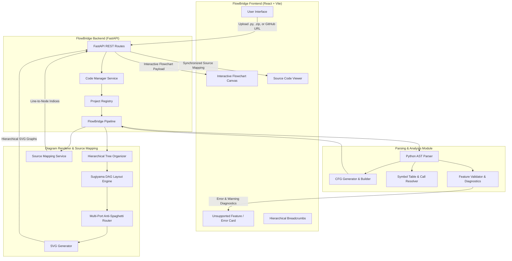

# FlowBridge — Code-to-Flowchart Visualizer

> **Capstone Project — Team: The Adaptables**  
> An automated, interactive software visualization platform that transforms Python code into clear, hierarchical control-flow diagrams (CFGs) with synchronized source code inspection.

---

## 👥 The Adaptables Team

| Team Member | Role | Primary Contributions |
|---|---|---|
| **Justin Bean** | Team & Integration Lead | Code Manager architecture, file/ZIP/GitHub ingestion, data contracts, and integration leadership. |
| **Jerry Phan** | Website Manager & Frontend Lead | React/Vite UI development, Project View, Flowchart Canvas integration, and file upload interface. |
| **Grace Medina** | Product Perspective & Source Mapping Lead | Source-code-to-flowchart node mapping, line-to-node indexing, and cross-view synchronization. |
| **Harsha Bonthu** | Requirements, Parsing & Analysis, Diagram Renderer Lead | AST traversal, CFG builder, call resolution, Sugiyama DAG layout engine, multi-port branch routing, and error diagnostics. |
| **Kevin Sanchez** | QA, Testing & Validation Lead | Test coverage, component validation, integration testing, and documentation verification. |

---

## 🚀 Project Overview

**FlowBridge** analyzes executable Python code and produces intuitive, visual flowcharts to help developers, students, and engineers understand complex execution paths, branching logic, loop structures, and error-handling routines.

Rather than flattening code into an overwhelming flowchart, FlowBridge organizes software into an intuitive **3-Level Hierarchy**:
1. **Level 1 — Project View:** High-level dependency hierarchy mapping file-to-file imports and standalone modules in a compact, structured layout.
2. **Level 2 — File View:** Module-level execution flow charting top-level statements, execution order, and entry points.
3. **Level 3 — Function View:** Detailed Control-Flow Graphs (CFGs) for individual functions, tracking decisions, loops, exceptions, and returns.

Clicking on any file or function drill-down node in the diagram navigates deeper, while clicking on any flowchart node highlights the corresponding lines in the source-code editor.

---

## 🏛️ System Architecture



---

## 📦 Module Breakdown

### 1. Frontend (`FlowBridgeFrontend`)
Built with **React 18**, **TypeScript**, and **Vite**.

- **Interactive Flowchart Canvas (`FlowchartCanvas.tsx`):**
  - Smooth pan, drag, and mouse-wheel zoom (centered around viewport).
  - Responsive **Fit-to-View** algorithm adapting dynamically to vertical linear flows, square project trees, or compact functions.
  - Interactive node clicking with visual selection highlight.
  - Symmetrical condition branches with clear True/False pill markers.
- **Source Code Viewer (`SourceCodeViewer.tsx`):**
  - Line-numbered source viewer with synchronized syntax display.
  - **Bidirectional Sync:** Clicking a line in the editor highlights the corresponding flowchart node; clicking a node scrolls the editor directly to the matching line.
  - Multi-file project browser with status badges (Ready, Unsupported, Failed).
- **Project Import Modal (`UploadModal.tsx` & `FileUploader.tsx`):**
  - **Python File (`.py`):** Single-script visualizer.
  - **ZIP Project (`.zip`):** Full multi-file repository analysis with cross-file dependencies.
  - **GitHub URL:** Direct import of public GitHub repositories without requiring a local clone.
- **Unsupported Feature Display & Error Handling (`App.tsx`):**
  - Displays friendly error cards when unsupported syntax (e.g. classes/OOP, async/await, lambdas, comprehensions) is uploaded.
  - Shows file name, exact line number, feature name, explanation, and an actionable recommendation.
  - Features a **"Highlight in Editor"** button that jumps directly to the problematic source line.
- **Diagram Export (`ExportModal.tsx`):**
  - Export flowcharts to vector **SVG**, high-resolution **PNG**, or **PDF**.

---

### 2. Backend Services & Code Manager (`FlowBridgeBackend`)
Built with **FastAPI** and **Uvicorn**.

- **API Endpoints (`api.py`):**
  - `POST /api/projects/file` — Ingest single Python file into project snapshot.
  - `POST /api/projects/zip` — Ingest multi-file ZIP archive and parse relative paths.
  - `POST /api/projects/github` — Fetch and unpack public GitHub repositories.
  - `POST /api/projects/{id}/render` — Execute full parsing, analysis, source mapping, and hierarchical SVG generation.
  - `GET /health` — Service health check.
  - `GET /viewer/` — Static mount for interactive browser-based viewer.
- **Code Manager (`service.py` & `readers.py`):**
  - In-memory archive reading and source decoding without writing temporary files to disk.
  - Path normalization, encoding detection (`utf-8`, `cp1252`, BOM), and size limit validation.
- **Project Registry (`registry.py`):**
  - In-memory thread-safe registry holding active project models and file snapshots.
- **Source Mapping Service (`SourceMapping/`):**
  - Generates bidirectional indices (`lineToNodes` and `nodeToLines`) linking AST span coordinates with generated diagram nodes.

---

### 3. Parsing & Analysis Engine (`FlowBridge_ParsingAndAnalysis`)
Built with Python's native **`ast`** module.

- **AST Analyzer (`ast_analyzer.py`):**
  - Traverses syntax trees to catalog function definitions, global calls, imports, returns, and variable scopes.
- **CFG Builder (`cfg_builder.py`):**
  - Constructs rigorous Control-Flow Graphs for procedural statements.
  - Handles conditionals (`if`, `elif`, `else`), loops (`for`, `while`), loop continuations (`break`, `continue`), and exception handling (`try`, `except`, `else`, `finally`).
  - Prunes redundant execution paths and enforces single canonical entry points.
- **Symbol Table & Call Resolver (`symbol_table.py` & `call_resolver.py`):**
  - Resolves internal function calls, direct imports (`import foo`), aliased imports (`import foo as f`), and selective imports (`from module import func`).
  - Links call sites to destination function graph IDs across multiple files.
- **Unsupported Feature Validator (`feature_validator.py`):**
  - Scans AST for language constructs outside FlowBridge's supported subset (Classes/OOP, Async/Await, Lambdas, Generator Expressions).
  - Emits structured diagnostics containing file ID, line number, column offset, feature code, and clear user-facing guidance.

---

### 4. Diagram Renderer & Layout Engine (`diagram_renderer`)
Custom **Sugiyama-style DAG Layout Engine** with dedicated anti-spaghetti channel routing.

- **Strict Top-to-Bottom Flow:**
  - **Start node** is always positioned at the very top (Rank 0).
  - **End/Stop node** is placed at the bottom (Rank `max + 1`) when reachable.
  - Real control-flow semantics are preserved without inventing fake End nodes for infinite loops.
- **Multi-Port Branch Separation:**
  - Condition diamonds exit **True** from the left vertex and **False** from the right vertex (two distinct origins) with orthogonal horizontal step-outs.
  - Branching statement nodes distribute exit ports across 25% and 75% width.
- **Channelized Orthogonal Routing:**
  - **Left Outer Gutter:** Dedicated parallel lanes for long-span exception and unhandled edges (`try/except`), dropping below the source node and routing around intermediate blocks.
  - **Right Outer Gutter:** Dedicated parallel tracks for loop back-edges (`while`, `for`, `continue`).
  - **Outer Bypass Channels:** Forward edges jumping more than 1 rank route along outer channels.
  - **Target Port Distribution:** Multiple edges entering the same node are sorted by source position and distributed evenly along the top edge, eliminating criss-cross tangling (**0 edge-node collisions across complex test suites**).

---

## ⚡ Quickstart & Installation

### Prerequisites
- **Python 3.12+**
- **Node.js 18+** & **npm**

---

### 1. Start the Backend API

Open a terminal in the project root:

#### PowerShell (Windows):
```powershell
$env:PYTHONPATH="FlowBridgeBackend;FlowBridge_ParsingAndAnalysis/src"
python -m uvicorn FlowBridgeBackend.api:app --host 127.0.0.1 --port 8000 --reload
```

#### Command Prompt (`cmd.exe`):
```cmd
set PYTHONPATH=FlowBridgeBackend;FlowBridge_ParsingAndAnalysis/src
python -m uvicorn FlowBridgeBackend.api:app --host 127.0.0.1 --port 8000 --reload
```

- **Backend API:** [http://127.0.0.1:8000](http://127.0.0.1:8000)
- **Interactive Swagger Docs:** [http://127.0.0.1:8000/docs](http://127.0.0.1:8000/docs)

---

### 2. Start the Frontend App

Open a second terminal in the project root:

```bash
cd FlowBridgeFrontend
npm install
npm run dev
```

- **Frontend App:** [http://localhost:5173](http://localhost:5173)

---

## 🧪 Verification & Testing

The repository includes comprehensive automated test suites covering all modules:

### 1. Parsing & Analysis Test Suite (284 Tests)
Validates AST parsing, CFG construction, loop constructs, exception blocks, and call resolution:
```bash
cd FlowBridge_ParsingAndAnalysis
python -m unittest discover -s tests -p "test_*.py"
```
*Result: **284/284 tests passed (100%)**.*

### 2. Frontend Production Build
Validates TypeScript compilation, React components, and Vite bundling:
```bash
cd FlowBridgeFrontend
npm run build
```
*Result: **Built in <300ms with 0 errors**.*

---

## 📂 Repository Directory Structure

```text
FlowBridge/
├── FlowBridgeFrontend/             # React 18 + TypeScript + Vite frontend
│   ├── src/
│   │   ├── components/
│   │   │   ├── FlowchartCanvas.tsx # Interactive SVG pan/zoom/select canvas
│   │   │   ├── SourceCodeViewer.tsx# Synchronized line-numbered code viewer
│   │   │   ├── UploadModal.tsx     # Import modal (file, ZIP, GitHub)
│   │   │   ├── ExportModal.tsx     # Diagram export modal (SVG, PNG, PDF)
│   │   │   └── StartButton.tsx     # Flowchart generation trigger
│   │   ├── types/                  # Shared TypeScript interfaces
│   │   ├── App.tsx                 # Main application state & error handling
│   │   └── App.css                 # Application styling
│   ├── package.json                # Dependencies manifest
│   └── vite.config.ts              # Vite configuration
│
├── FlowBridgeBackend/              # FastAPI backend services
│   ├── diagram_renderer/           # Hierarchical diagram rendering module
│   │   ├── layout.py               # Sugiyama DAG layout & anti-spaghetti router
│   │   ├── renderer.py             # SVG generator with clickable elements
│   │   ├── organizer.py            # Hierarchical tree builder
│   │   └── runner.py               # Diagram pipeline runner
│   ├── SourceMapping/              # Bidirectional source-to-node mapping
│   ├── api.py                      # FastAPI REST routes and CORS configuration
│   ├── pipeline.py                 # End-to-end integration orchestrator
│   ├── service.py                  # CodeManager ingestion service
│   ├── registry.py                 # In-memory demo project registry
│   └── models.py                   # Pydantic project & file models
│
├── FlowBridge_ParsingAndAnalysis/  # Python parsing & CFG analysis engine
│   ├── src/flowbridge_analysis/
│   │   ├── ast_analyzer.py         # AST syntax traversal
│   │   ├── cfg_builder.py          # Procedural CFG generator
│   │   ├── call_resolver.py        # Import and function-call resolution
│   │   ├── feature_validator.py    # Unsupported syntax diagnostics
│   │   ├── symbol_table.py         # Symbol scope indexing
│   │   └── pipeline.py             # Analysis pipeline entry point
│   └── tests/                      # 284 unit tests
│
├── rendered_diagrams/              # Live SVGs served by /viewer
├── tests/                          # Integration test suites & test fixtures
├── README.md                       # Comprehensive repository documentation
└── .gitignore                      # Git exclusion rules
```

---

## 📄 License & Academic Integrity

Developed for the **Senior Capstone Design Project** by **The Adaptables**.  
All rights reserved.
